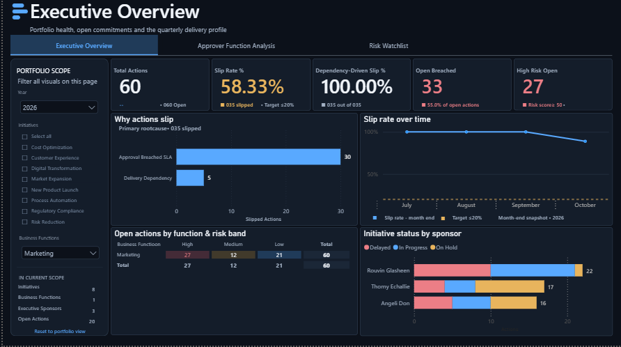
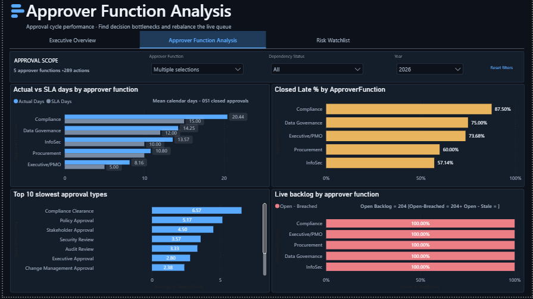
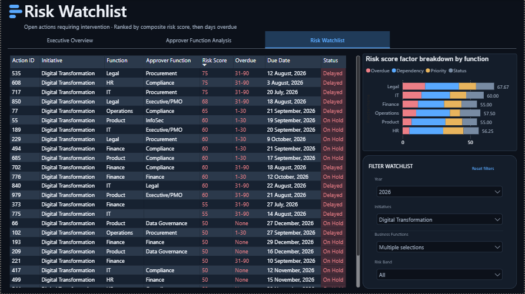

# 🚀 Executive Strategic Initiatives & Operational Risk Analytics Platform

## 📋 Project Overview
This repository contains a comprehensive, end-to-end business analysis and technical implementation package designed to automate cross-functional action tracking, dependency governance, and multi-tier Service Level Agreement (SLA) escalations.

The platform transitions an informal, unmonitored **AS-IS workflow** (where approval turnaround times frequently exceeded 200+ days) into a rigorous, automated **TO-BE governance engine** featuring automated SLA countdown timers, non-interrupting boundary alerts, 90-day stale item flagging, and a risk-ranked executive PMO watchlist.

---

## 🏗️ Process Architecture (AS-IS vs. TO-BE)
The workflow was mapped across four swimlanes (**Action Owner, Approver Function, PMO, Executive Sponsor**) using BPMN 2.0 standards:
- **AS-IS Process:** Relies on manual action logging, informal email/chat requests, and reactive PMO discovery during status meetings.
- **TO-BE Process:** Enforces structured metadata capture, automated SLA clock initiation, tiered escalation paths, and a risk-scored PMO dashboard.

### 📐 Visual Workflows & Frameworks
- 📌 **[View AS-IS vs TO-BE Process Flow](AS-IS%20vs%20TO-BE.drawio.png)** (Inferred/Validated manual pipelines and optimized state machine)
- 📌 **[View Stakeholder RACI Matrix](Stakeholder%20Matrix%20(RACI).png)** (Cross-functional mapping)

---

## 🗄️ Technical Data Architecture (SQL & Database)
The backend relational database is structured to support transactional action logging, dimensional modeling, and dynamic risk scoring.

- **[`schema.sql`](schema.sql):** Contains staging tables (`Action_Log_Raw`), dimensions (`Dim_ApproverFunction`, `Dim_BusinessFunction`, `Dim_Initiative`, `Dim_Dependency`, `Dim_Date`), and fact tables (`Fact_Action`, `Fact_Dependency`).
- **[`views.sql`](views.sql):** Implements analytical views (`vw_ActionSlippage`, `vw_DependencyPerformance`, `vw_ActionRisk`, `vw_ApproverScorecard`) that drive real-time risk scoring and SLA breach monitoring.

---

## 📊 Executive Power BI Dashboard
The Power BI reporting suite (`Enterprise%20PMO%20Analytics%20Platform.pbix`) provides C-suite executives and PMO leads with real-time operational visibility across three core views:

1. **Executive Overview**  
   Tracks overall portfolio health, slip rates, root causes, and initiative status by sponsor. ****
2. **Approver Function Analysis**  
   Identifies decision bottlenecks, actual vs. SLA turnaround times, and live backlogs by department. ****
3. **Risk Watchlist**  
   Ranks open actions dynamically by composite risk score and overdue duration. ****

### 🎥 Power BI Dashboard Walkthrough
Watch a quick 1-minute demonstration of the interactive dashboard filters, risk scoring logic, and exception-tracking views using the native player below:

<video src="Enterprise%20PMO%20Analytics%20Platform-Compressed.mp4" width="100%" controls></video>

---

## 📑 Governance Documentation & Requirements
The complete project documentation package is stored in the core repository window:
- **[`BRD.md`](BRD.md):** Full Business Requirements Document covering Project Scope, RACI Matrix, and Functional Requirements (FR-01 through FR-07).
- **[`OPERATIONS-REQUIREMENT TRACEABILITY MATRIX AND UAT-TEST CASES.pdf`](OPERATIONS-REQUIREMENT%20TRACEABILITY%20MATRIX%20AND%20UAT-TEST%20CASES.pdf):** Maps functional requirements directly to UAT scripts (UAT-01 through UAT-07) and expected validation results.

---

## 📂 Repository Structure
```plaintext
executive-governance-analytics-platform/
│
├── README.md                                             <-- Project overview & portfolio documentation
├── OPERATIONS-REQUIREMENT TRACEABILITY MATRIX AND UAT-TEST CASES.pdf <-- Core traceability & validation script
├── BRD.md                                                <-- Business Requirements Document
├── AS-IS vs TO-BE.drawio.png                             <-- BPMN 2.0 Process Workflow Architecture
├── Stakeholder Matrix (RACI).png                         <-- Team governance assignment map
├── schema.sql                                            <-- Target DDL structures & primary/foreign keys
├── views.sql                                             <-- Dynamic calculations & calculation wrappers
├── Enterprise PMO Analytics Platform.pbix                <-- Live Power BI desktop dashboard application
├── Enterprise PMO Analytics Platform-Compressed.mp4      <-- High-efficiency walk-through video (2.7 MB)
├── pbi_db_executive_overview.png                         <-- Portfolio tracking dashboard view
├── pbi_db_approver_function_analysis.png                 <-- Functional delay mapping view
├── pbi_db_risk_watchlist.png                             <-- Dynamic operational risk ranking matrix
└── Action_Log_Raw.csv                                    <-- Source workbook dataset
```

